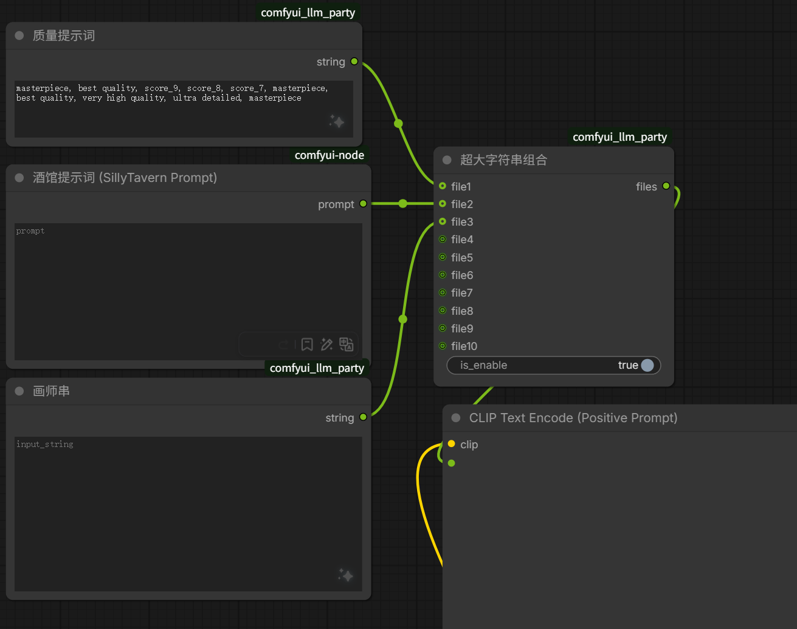
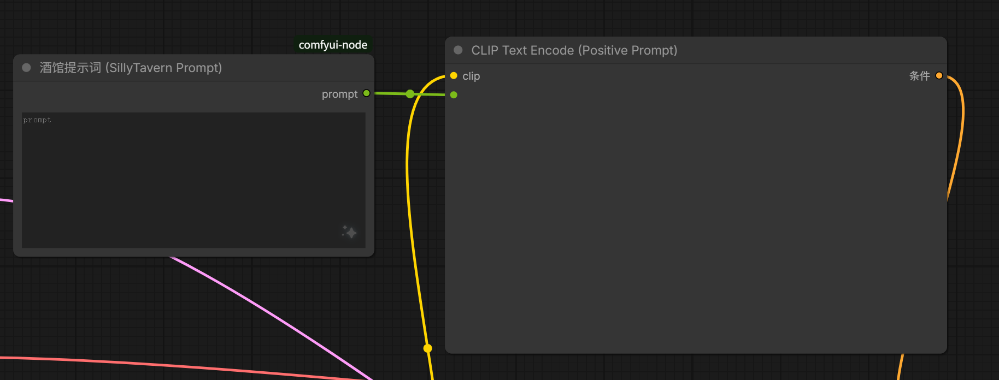

# STCB — SillyTavern × ComfyUI 桥接

基于SillyTavern和ComfyUI的文生图插件。

和其他文生图插件的区别：不需要将ComfyUI中的工作流导出后放在插件中了，而是直接使用当前ComfyUI浏览器前端使用的工作流。
代价：不仅需要在SillyTavern中安装插件，还需要再ComfyUI中安装插件，并再启动一个桥接服务器。


---

## 目录结构

| 文件夹 | 作用 | 安装位置 |
|---|---|---|
| [`stcb/`](./stcb) | 酒馆扩展 | 拖进酒馆的扩展目录 |
| [`comfyui-node/`](./comfyui-node) | ComfyUI 自定义节点包 | 放进 ComfyUI 的 `custom_nodes` |
| [`bridge-server/`](./bridge-server) | 桥接服务（独立进程） | 位置随意 |

```
stcb/
├── manifest.json              扩展声明
├── index.js                   主逻辑
├── parse.js                   解析与判定
├── settings.html              设置面板
├── style.css
└── test_parse.mjs             解析逻辑自测

comfyui-node/
├── __init__.py                「酒馆提示词」节点
├── web/
│   ├── stcb_bridge.js         页面脚本
│   └── stcb_locate.js         节点定位
└── test_locate.mjs            节点定位自测

bridge-server/
├── bridge_server.py
├── 启动桥接服务.bat
└── test_bridge.py             端到端自测
```

自测跑法（三个都应当是「失败 0 项」）：

```bash
cd comfyui-node  && node test_locate.mjs
cd stcb          && node test_parse.mjs
cd bridge-server && python test_bridge.py
```

---

## 安装

### 组件 1：ComfyUI 节点包

把整个 `comfyui-node` 文件夹复制到 ComfyUI 的 `custom_nodes` 目录下，**重启 ComfyUI**。

```
<ComfyUI>/custom_nodes/comfyui-node/
    __init__.py
    web/stcb_bridge.js
    web/stcb_locate.js
```

重启后打开浏览器控制台（F12），应当能看到 `[STCB]` 开头的日志。
节点菜单里也会多出一个分类 `STCB`。可以在节点中找到名为`酒馆提示词`的节点。

> 装了 ComfyUI Manager 的话，也可以用「从 URL 安装」的方式。

### 组件 2：酒馆扩展

**把整个 `stcb` 文件夹放入酒馆的扩展目录**，文件夹名不要改。

酒馆支持两个扩展目录，**放哪个都行**：

| 位置 | 特点 |
|---|---|
| `public/scripts/extensions/third-party/` | 全局扩展，所有用户共享。**推荐放这儿** |
| `data/<你的用户名>/extensions/` | 用户扩展，跟着用户数据走 |

放好后的结构：

```
<SillyTavern>/public/scripts/extensions/third-party/stcb/
    manifest.json
    index.js
    parse.js
    settings.html
    style.css
```

然后**刷新酒馆页面**（Ctrl+F5）即可，不用重启服务。

在酒馆的「扩展」面板里应当能看到 **STCB 桥接 (ComfyUI)** 这一项。

> ⚠️ 两个目录**同一个名字不要都放**，否则以全局那份为准。

### 组件 3：桥接服务

**位置随意**，它是个独立进程。

双击 `启动桥接服务.bat`。脚本会：

1. 找 Python（先看旁边的 `python-path.txt`，再找 PATH 里的 `python`）
2. 检查 aiohttp，没有会请求安装
3. 启动服务

看到这样的输出就算成功：

```
STCB 桥接服务已启动
  酒馆扩展请连: http://127.0.0.1:8765
  ComfyUI 页面请连: ws://127.0.0.1:8765/ws
  状态查询: http://127.0.0.1:8765/api/status
```

**如果找不到 Python**：在 `bridge-server` 目录下建一个 `python-path.txt`，
里面只写一行 Python 完整路径。一般来说，装了 ComfyUI 的话，它自带的 Python 就能用，
通常在 `<ComfyUI>/python_embeded/python.exe`。

---

## 使用

### 0. 在工作流里放一个「酒馆提示词」节点（**必做**）

这是整个方案的核心。在 ComfyUI 节点菜单里搜索 **「酒馆提示词」**（分类 `STCB`），
拖进画布，然后把它**接到想让提示词出现的位置**：

```
[头发质感/画风] ──┐
[画师串]        ──┼──▶ [超大字符串组合] ──▶ [CLIPTextEncode]
[酒馆提示词 ★] ──┘
```


也可以直接接到 CLIPTextEncode 的 `text` 输入。



**位置和顺序完全由工作流决定**

> 节点上的文本框不用填，它由酒馆在生成前自动写入。
> 生成时你能在界面上实时看到当前提示词。
>
> 想用别的工作流，记得**每个工作流都要放一个**这个节点。

**如果忘了放**，点按钮会直接报错并告诉你怎么加。

### 1. 引导 AI 输出提示词

默认格式采用 `image###` 和 `###` 包裹：

```
image###sfw, 1girl, from front, braided black hair, amber eyes, holding two-handed axe, snowy mountain background###
```


**标记里换行也没关系**。AI 经常这样写：

```
image###sfw, 1girl, from front, amber eyes, snowy mountain
###
```

这种也能正确识别（扩展会在收到消息时自动处理）。

> ⚠️ 这会**影响实际的消息内容**，也就影响下一轮发给 AI 的文本。

> 如果你会把 `image###...###` 用正则从提示词里剔掉（省 token），那就没有影响。

> 如果你**不**剔，注意 AI 会看到压平后的版本（换行变空格）。

之前已经存下来的、带换行的消息，扩展在加载聊天时会自动修一遍。
也可以在扩展设置里点「**修复历史消息**」手动触发。

标记可以在扩展设置里改（比如换成 `<<<` / `>>>`）。

### 2. 点按钮

AI 回复里被标记包裹的内容会自动变成一个 **「生成图片」按钮**：

- 标记夹在正文中间也可以，前后的文字会原样保留
- 一条消息里出现多个标记，会生成多个按钮

另外还支持**备选方式**：用 `comfy` 语言标记的代码块也会变成按钮（可在设置里改或关掉）。

| 操作 | 行为 |
|---|---|
| 单击 | 生成图片 |
| 长按 1.2 秒 | 弹出编辑框，改提示词 |
| 排队中 | 按钮变「排队中 · 点击取消」 |
| 生成中 | 按钮变「生成中…」并转圈，防重复点击 |
| 成功后 | 按钮变「再生成一张」 |

### 2b. 连续生成 / 取消排队中的任务

**可以直接连着点多个按钮**——每个任务会立刻提交进 ComfyUI 自己的队列，
按点击的顺序依次执行。ComfyUI 界面上可以查看。

按钮的状态会跟着走：

| 状态 | 显示 | 能做什么 |
|---|---|---|
| 排队中 | `排队中 · 点击取消` | **再点一次就从队列里撤掉** |
| 生成中 | `生成中…` | 不能取消（按设计） |
| 完成 | `再生成一张` | 再点就是重新生成 |

**并发上限**在扩展设置里：「同时最多几个任务」，默认 **5**，填 `0` 表示不限制。

> **为什么生成中不让取消？** 中断到一半的图没有意义，
> 而且容易让人误以为"点了取消就没事了"。排队中的可以随时撤，开始跑了就让它跑完。

### 3. 图片会发给 AI 吗

**默认不会。** 

酒馆的原生媒体系统默认会把图片内联进提示词，只要你在用 Chat Completion + 视觉模型，
图片就会被当成 `image_url` 发过去。一张 1024×1024 大约 **1000+ token**，
而且让角色"看到"自己刚生成的插图常常会把对话带偏。

所以本扩展默认把图片存在消息的**自定义字段**里，酒馆不认识这个字段，自然不会内联。

想切换的话，扩展设置里有「图片存储方式」：

| 模式 | 图片进提示词 | 显示效果 |
|---|---|---|
| **私有**（默认） | ❌ 不会 | 缩略图排布，点击放大（Esc 关闭） |
| 酒馆原生媒体 | ✅ 会（视觉模型） | 原生画廊、左右滑动、全屏 |

图片显示的位置，由「图片显示位置」控制：

| 位置 | 效果 |
|---|---|
| **紧跟按钮**（默认） | 标记在哪，按钮就在哪，生成的图也显示在那——图文混排 |
| 消息末尾 | 图片统一放在回复块最下方（st-chatu8 的默认行为） |

**多个按钮时不会串台**，各自的图会显示在各自的按钮下面。

**同一个按钮重复生成**会累积多张：图片下方出现 `‹ 2/3 ›` 的切换条，
**新生成的会自动切出来**，不用手动翻。想看旧的用箭头左右翻。

### 3b. 图片的查看与管理

同一个按钮下可以生成多张图，**一次只显示一张**：

```
[生成图片]              ← 按钮
┌──────────────┐
│      图片    │
└──────────────┘
 ‹ 2/3 ›   隐藏        ← 导航 + 隐藏
```

- **‹ ›** 切换同一提示词下的不同图片
- **点击图片** 全屏查看，全屏里也能左右切换（也可以按 ← → 键），Esc 关闭
- **隐藏** 收起图片，只留一个「显示图片 (N)」的小按钮

**提示词改掉之后，旧图会自动隐藏**（因为认不出归属了）。想彻底清掉它们：

> 扩展设置 → **清理孤立图片**

它只清理聊天记录里的引用，**磁盘上的图片文件不会被删**，可以放心。

### 3c. 图片存在哪

**由酒馆自己托管。**

| | 位置 |
|---|---|
| 原始文件 | ComfyUI 的 `output/`（SaveImage 节点写的） |
| **酒馆用的** | 酒馆数据目录下的 `user/images/stcb/` |


### 4. 换工作流 / 改参数

**不需要在酒馆里做任何配置。**

- 换工作流：在 ComfyUI 里切换到另一个工作流即可，下次点按钮就用新的
- 改底模 / LoRA / 权重 / 步数 / 增加节点：在 ComfyUI 里直接修改即可，**不用保存**

---

## 前置条件与约束

| 项目 | 要求 |
|---|---|
| ComfyUI 网页 | **必须开着**，且停在目标工作流那一页 |
| ComfyUI 启动参数 | **不需要改** |
| 桥接服务 | 需要常驻运行 |

**为什么必须开着 ComfyUI 页面？** 因为触发方式相当于替你往节点里粘贴提示词、
替你点 Queue 按钮。好处是不需要导出工作流、生成过程你还能在界面里实时看到。

---

## 排查

| 现象 | 处理 |
|---|---|
| 按钮点了没反应，提示「ComfyUI 页面未连接」 | ComfyUI 网页没开，或节点包没装好。看 ComfyUI 控制台有没有 `[STCB]` 日志 |
| 按钮一直显示「生成中…」 | 到 ComfyUI 界面看是不是卡住了；桥接服务窗口会有日志 |
| 提示「没有找到『酒馆提示词』节点」 | 当前工作流里没放那个节点。从节点菜单搜「酒馆提示词」加一个 |
| 提示「节点被旁路或静音」 | 检查那个节点是不是被 Bypass/Mute 了，或者它的下游没连到输出节点 |
| 生成出来的图不是想要的 | 检查 ComfyUI 里当前打开的是不是目标工作流 |
| 点了按钮显示成功，但看不到图片 | 打开 F12 看 `[STCB]` 日志 |
| `image###...###` 没变成按钮 | 检查扩展设置里的触发标记有没有被清空 |
| 桥接服务窗口一闪而过 | 双击时出错会 pause，看清提示。多半是没找到 Python |

---

## 已知限制

- ComfyUI 页面必须开着
- 桥接服务需要手动启动，且要常驻
- 图片由酒馆托管，跟着酒馆数据一起备份即可
- 桥接服务默认只监听 `127.0.0.1`，没有鉴权。要暴露到局域网/公网的话，务必自己加一层防护
